# GAZE V2: design and style

This describes how GAZE V2 looks and why. Every value below is taken from the
project's style files, `src/styles/tokens.css` and `src/styles/app.css`.

## 1. Design goals

GAZE V2 is used by a person who controls the screen **with their eyes**.
Webcam eye tracking is not exact, and looking at something for a long time is
tiring. So the design follows five rules:

1. **Big targets.** Every button is at least 56 px tall (`--target-min:
   3.5rem`). Keys and home cards are much bigger.
2. **Gaps between targets.** A look that lands in a gap selects nothing, so
   the dot can't flicker between two neighbouring buttons. The gap is
   `--gap-target: 0.75rem`.
3. **No scrolling.** Eyes can't scroll. Long lists are split into pages with
   large **Previous page** and **Next page** buttons, and Home always fits on
   one screen.
4. **No hover-only effects.** Everything the eye needs to know is shown by
   colour, outline or text, never only when a mouse hovers.
5. **Calm, restrained colours.** Neutral greys, one indigo accent that means
   "this is what you're looking at", and status colours (green, amber, red)
   used only for status.

## 2. Layout

```
┌────────┬───────────────────────────────────────────────┐
│  Home  │  Page title          [music]  [status pill]   │  top bar
│  Talk  ├───────────────────────────────────────────────┤
│  Type  │  Warning banner (only when there is a problem)│
│  Needs ├───────────────────────────────────────────────┤
│ Symbols│                                               │
│  Calls │              page content                     │
│  Music │     (big cards, keys or lists with pages)     │
│  News  │                                               │
│Settings│                                               │
└────────┴───────────────────────────────────────────────┘
 navigation rail
```

- **Navigation rail** (left side, about 104–136 px wide): 9 large buttons with
  an icon and a short name. On phones it moves to a bar along the bottom.
- **Top bar:** the page title, a mini music player, and the eye-tracking
  status pill.
- **Banner:** appears only when something is wrong (for example "Face not
  found" or "Camera problem") and always says what to do.
- **Typing keyboard:** uses the **full screen** (the rail is hidden) so the
  keys can be as big as possible.
- **Calibration:** a separate full-screen dark page with one dot at a time
  (25 dots to learn from plus 8 check dots).

## 3. Colour themes

Three themes, chosen in **Settings → Display**. Every text-and-background pair
meets the WCAG AA contrast standard, and most meet AAA.

| Role | Light (default) | Dark | High contrast |
|---|---|---|---|
| Page background | `#f6f7fb` | `#0b0d17` | `#000000` |
| Card / button | `#ffffff` | `#131627` | `#000000` |
| Text | `#0f1222` | `#eceefb` | `#ffffff` |
| Secondary text | `#555c74` | `#a9aecb` | `#ffffff` |
| Border | `#e3e6ef` | `#262b45` | `#ffffff` |
| **Accent (indigo)** | `#4f46e5` | `#a5b4fc` | `#ffe600` (yellow) |
| Side menu | dark ink `#11142a` | `#080a12` | black |
| Focus outline | `#be185d` | `#f9a8d4` | `#00e5ff` |
| Success | `#166534` | `#5bd28a` | `#3dff7a` |
| Warning | `#8a5300` | `#f2b84b` | `#ffb000` |
| Danger | `#b42318` | `#ff8a7a` | `#ff6b6b` |
| Gaze dot | pink `rgba(190,24,93,0.9)` | pink `rgba(249,168,212,0.95)` | cyan `#00e5ff` |

Green appears only as the Success status colour, never as the theme colour.

**Home icon colours.** Each Home card has its own small coloured icon chip, so
a feature is found at a glance: Communicate indigo, Type a message violet,
Quick needs rose, Symbols amber, Call someone sky blue, Music fuchsia, News
orange. The colour is only on the icon chip. Selection, dwell and focus always
use the accent colour. In high contrast every icon is yellow.

The calibration screen and the Classic keyboard always use a **dark**
background (`#0e1116`), because a white dot on a dark screen is easiest to
look at and causes the least glare.

## 4. Text

- **Font:** Inter if it is installed, otherwise Segoe UI on Windows, with fallbacks to the system font, Roboto and
  Noto Sans. **Tamil** text uses Noto Sans Tamil, Latha or Nirmala UI.
- **Base size:** 18 px (the "Large" setting is the default), line height 1.5.
- **Text size setting:** Normal (16 px), Large (18 px), Extra large (21 px).
  Everything scales with it.
- **Weights:** button labels 650 (semi-bold), titles 700–750 (bold), hints
  500.
- **Keyboard letters** grow with the screen height, from 1.4 rem up to
  2.8 rem.

## 5. Shapes and spacing

- **Rounded corners:** 10 px (small), 14 px (buttons), 20 px (cards, panels
  and Home cards).
- **Spacing scale:** 4, 8, 12, 16, 24 and 32 px.
- **Borders:** 1.5 px on buttons in light and dark, 2 px in high contrast.
- **Shadows:** soft layered shadows in light, a deeper soft shadow in dark,
  none in high contrast. Main buttons (Start, Play, the chosen way to talk)
  have a deep indigo fill with a soft indigo glow.
- **Hover (mouse only):** a button gets a slightly bigger shadow. Nothing
  moves, so the 12 px gaps stay exact. No hover shadow in high contrast.
- **Page background:** a very faint indigo glow in the top-right corner.

## 6. How a gaze button behaves

All selectable buttons share one style (`.gz` in `app.css`) and one behaviour.

| State | What you see |
|---|---|
| Normal | White card, grey 2 px border |
| **Looking at it (dwell)** | Indigo border plus a 3 px indigo outline. A light indigo fill grows from left to right, with a **6 px indigo bar along the bottom**, showing how long is left. |
| **Selected** | A short indigo flash (0.45 s) and an optional soft tick sound |
| **Just selected (locked)** | Dashed indigo border. It won't select again until the eyes move away, so one long look never types "AAAA". |
| Current page or switched on | Light indigo background with an indigo border |
| Disabled | Flat grey background, plain border, no shadow, grey text that is still readable (5.4:1). High contrast uses a dashed border instead. |
| Danger buttons (Call for help, Clear) | Red border and light red background |

**Dwell time** (how long you look before a button is selected) is set in
Settings, from 0.5 to 3 seconds. Some buttons take longer, so they are
harder to press by accident:

- Navigation buttons: ×1.2
- Call: ×1.3
- Clear and Call for help: ×1.6

## 7. Eye-tracking feedback

- **Gaze dot:** a 30 px ring showing where the app thinks you're looking. It
  can be turned off in Settings.
- **Status pill** (top right) is always honest: *Not started*, *Needs
  calibration*, *Starting camera*, *Eye tracking on*, *Face not found*,
  *Eyes not visible* or *Camera problem*.
- **Pause eyes** stops all selection except the Resume button.
- **Diagnostic panel:** opening the app with `?gazedebug` shows a black panel
  with live gaze numbers (for testing only).

## 8. Pages at a glance

| Page | Main design |
|---|---|
| Home | Status card and current message side by side, then a **Talk** row (4 cards) and an **Everyday** row (Calls, Music, News, Call for help). Always fits the screen |
| Communicate | The message bar plus three big choices: Type, Quick needs, Symbols |
| Keyboard | Full screen. A word-suggestion bar above 10-key rows (A–Z or QWERTY), or 6 large tiles for lower accuracy |
| Quick needs | Phrase cards in 4 groups. The chosen phrase is shown very large and spoken |
| Symbols | Emoji cards with a text label |
| Calls | Contact cards; choosing one opens a dialog with Call, SMS and WhatsApp |
| Music | A "now playing" panel with large controls, and a song list split into pages |
| News | English or Tamil tabs, headline cards, and a reader view with Read aloud |
| Settings | Category list on the left (Eye control, Display, Speech, Keyboard, Phrases & symbols, Gaze model) and compact setting rows on the right. Eye control has a live camera preview |

## 9. Accessibility

- High-contrast theme and three text sizes.
- Works by eye gaze, mouse or head pointer (dwell), touch, or keyboard.
- Visible keyboard focus outline (3 px blue, or yellow in dark mode).
- Every icon button has a text label, and status messages are announced to
  screen readers.
- English and Tamil text for every phrase and symbol.

## 10. Where to change the design

- **Colours, fonts, sizes, corners:** `src/styles/tokens.css`. Change a value
  once and it updates everywhere.
- **Layout and component styles:** `src/styles/app.css`.
- **Calibration and Classic keyboard screens:** `src/index.css`.

## 11. What it looks like (screenshots)

> These screenshots show the look **before** the October redesign. The new look is in `docs/screenshots/redesign/` and described in [REDESIGN-REPORT.md](REDESIGN-REPORT.md).

All screenshots were taken in Chrome at 1366×768, which is a common laptop
size. The camera was replaced by the built-in eye simulator. The blue ring is
the gaze dot. The music list and news headlines are **test data** used for
testing, not your songs or real news.

### Calibration

| Before calibrating | During calibration (dark screen, one dot at a time) |
|---|---|
| 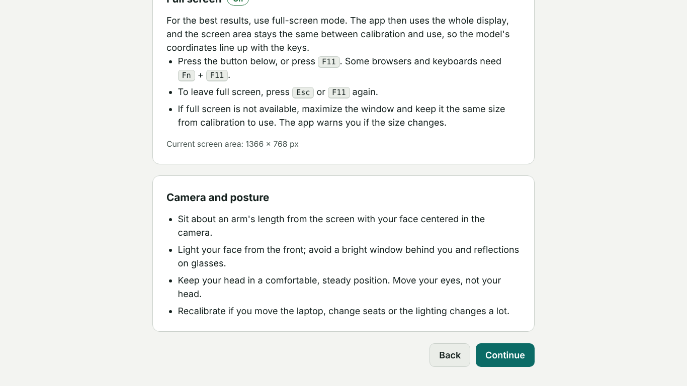 | 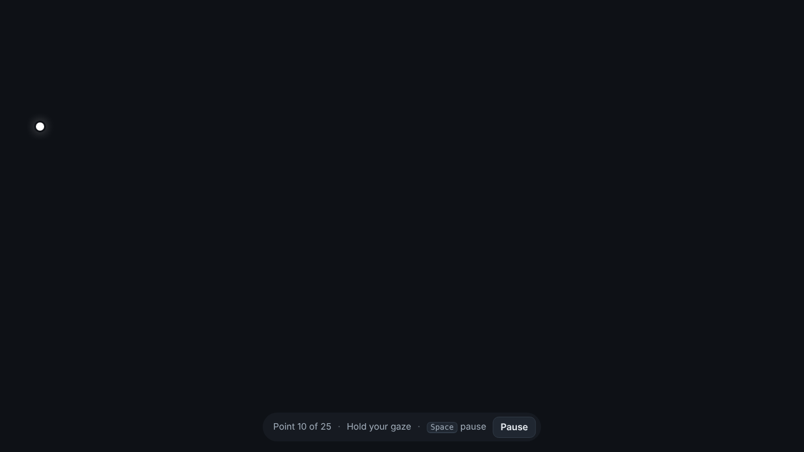 |

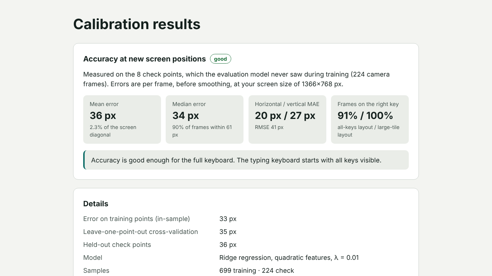
*Calibration results: the accuracy and the buttons to start eye control.*

### Home

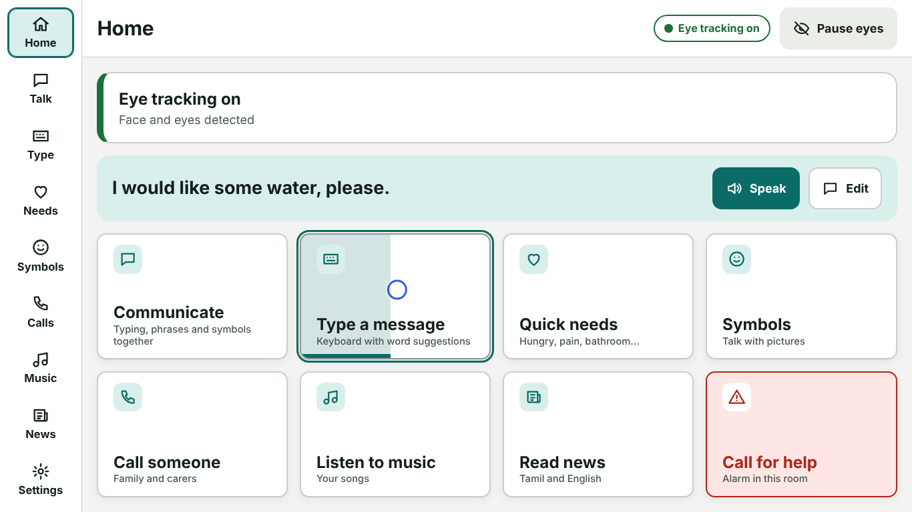
*Home with eye tracking on. The person is looking at "Type a message": the
indigo outline and the fill growing from the left show the dwell progress.*

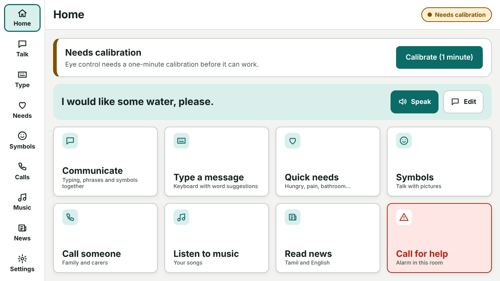
*Home before the first calibration.*

### Communicating

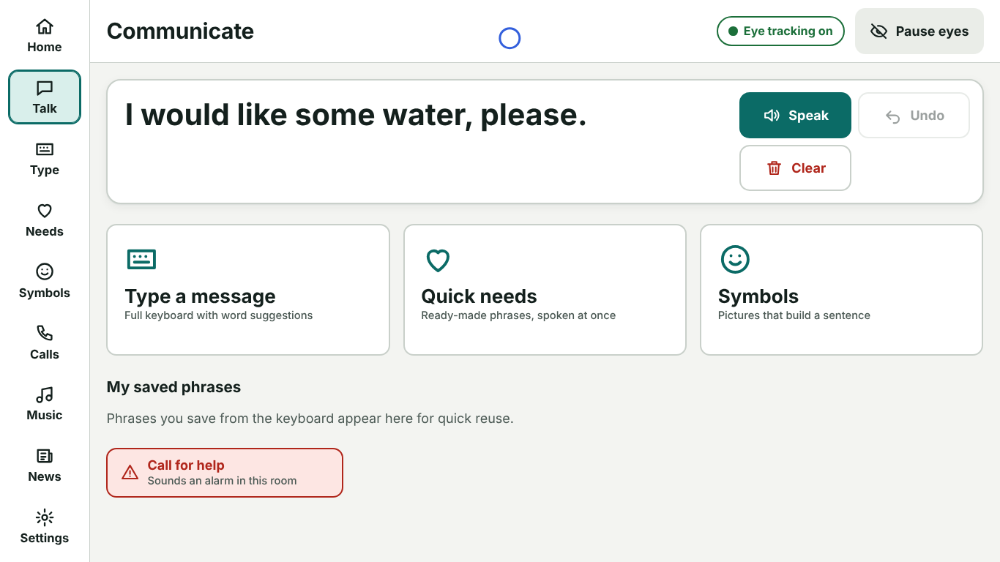
*Communicate: the current message and the three ways to build it.*

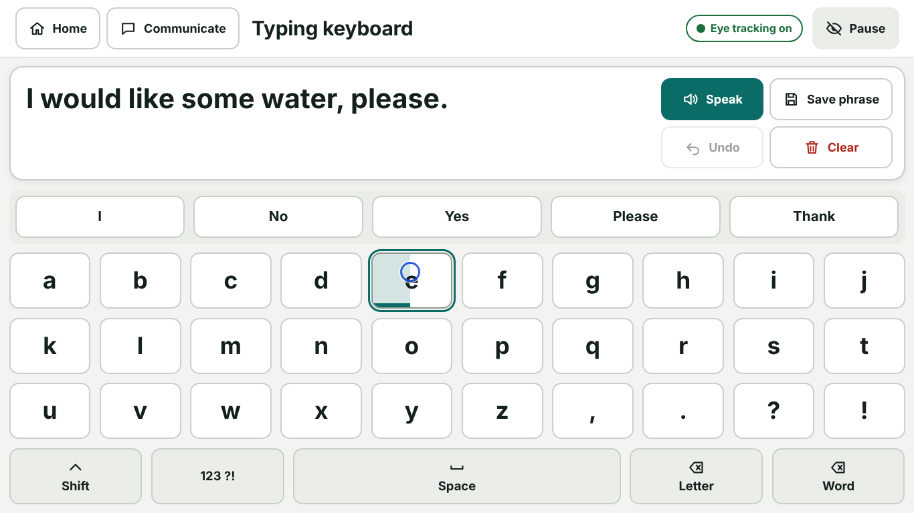
*Full-screen keyboard with the word-suggestion bar. The person is looking at
the letter E.*

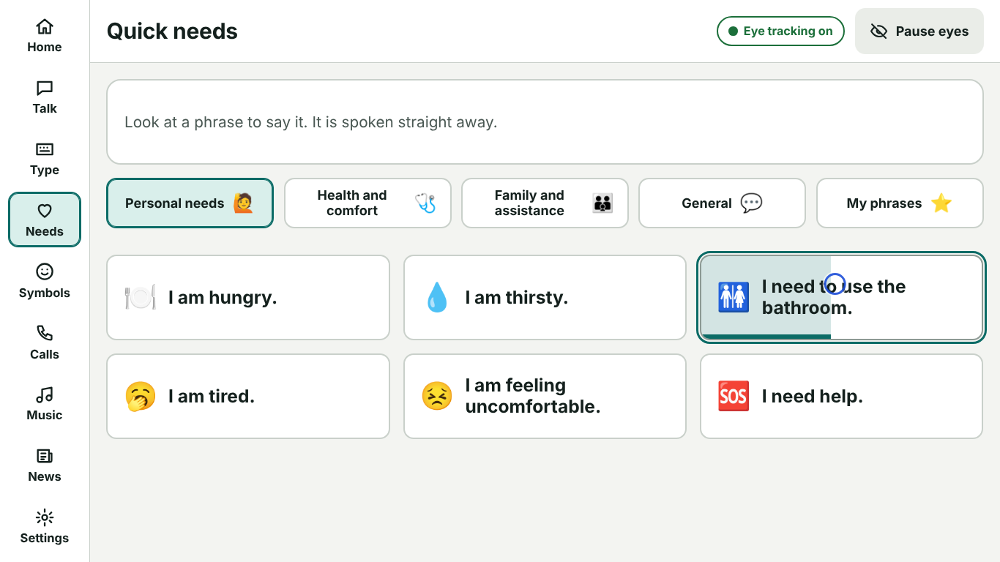
*Quick needs: phrase cards in groups, with dwell progress on one phrase.*

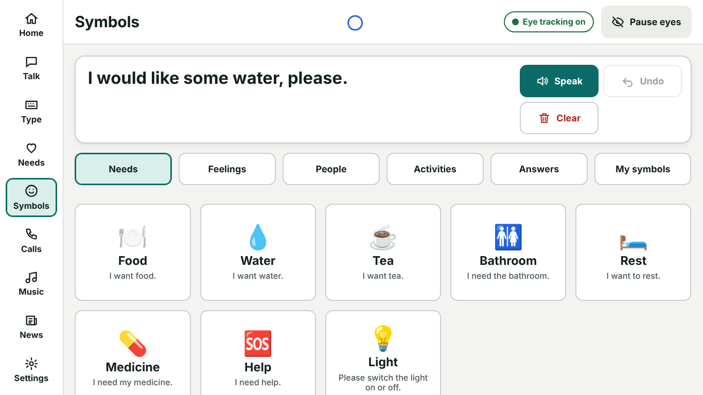
*Symbols: picture cards that add sentences to the message.*

### Calls, music and news

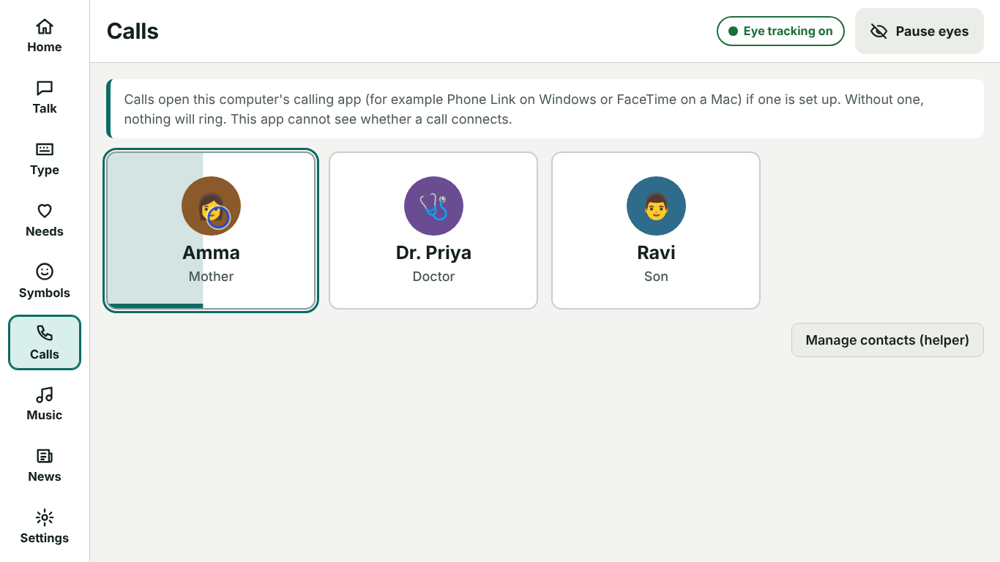
*Calls: contact cards (the contacts are examples).*

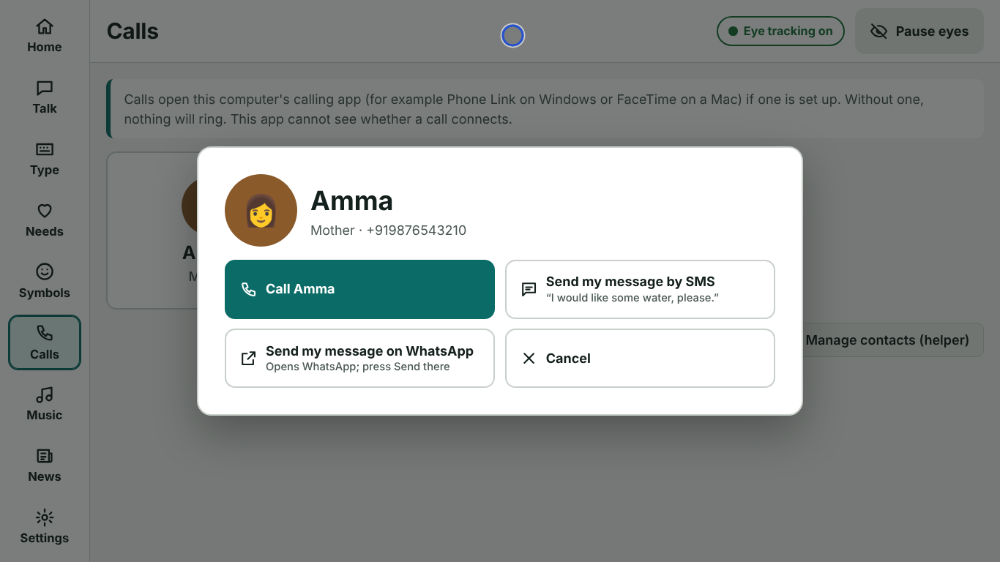
*Choosing a contact opens a dialog. Only its buttons can be selected while it
is open.*

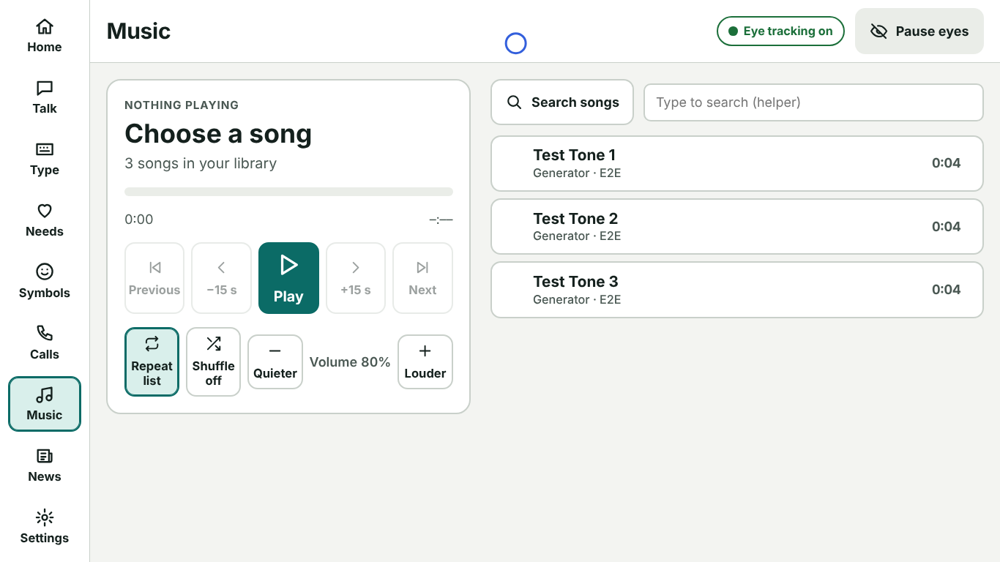
*Music: large playback controls and the song list (test tones shown).*

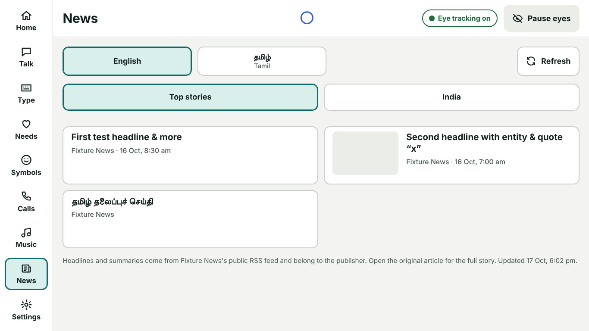
*News: language and topic tabs and headline cards (test feed shown).*

### Settings and themes

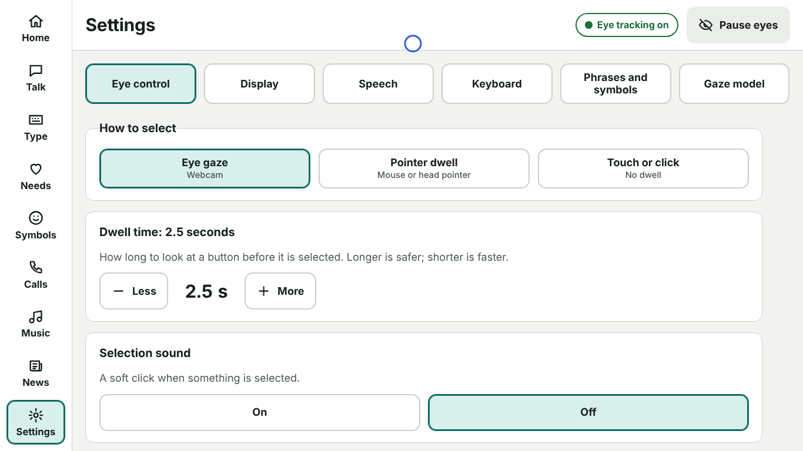
*Settings, Eye control tab.*

| Dark theme | High-contrast theme |
|---|---|
| 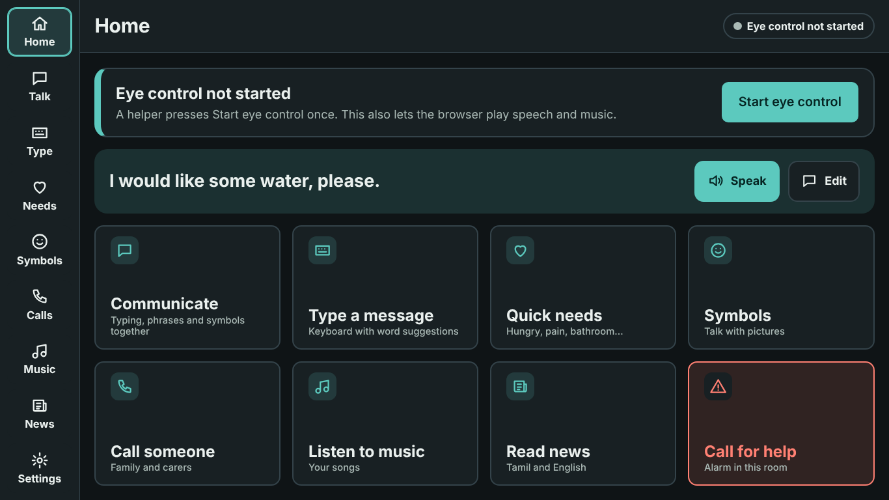 | 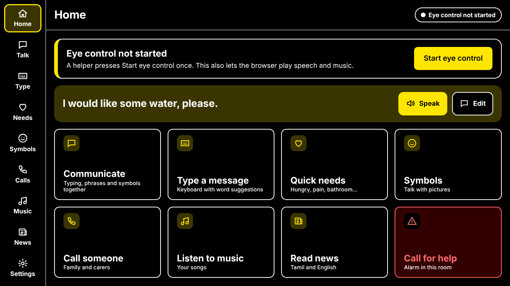 |
